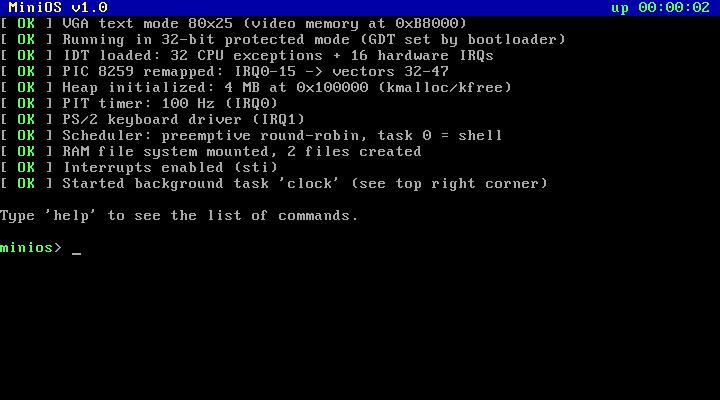
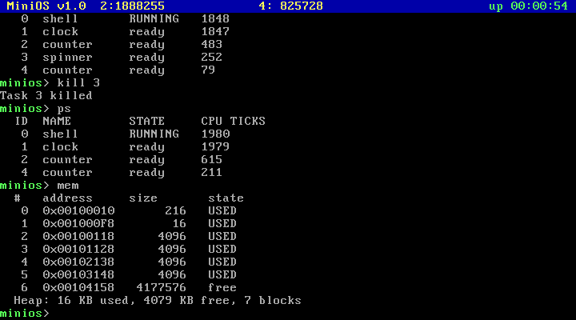
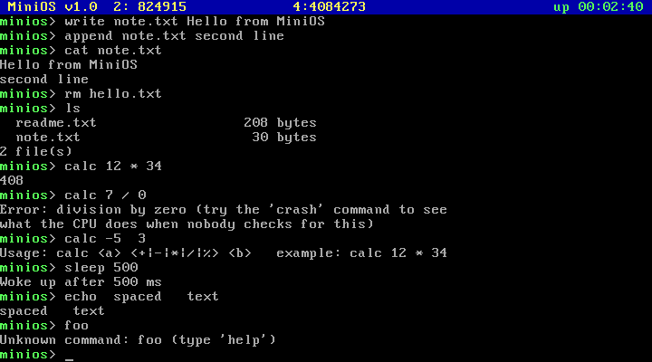
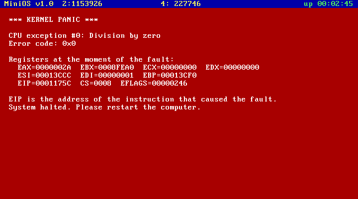

# MiniOS — учебная операционная система

MiniOS — маленькая, но **настоящая** операционная система для компьютеров с процессором x86.
Она загружается сама, без Windows или Linux: с образа диска в эмуляторе QEMU, а при желании и на реальном компьютере.
Её задача — **показать, как работает ОС изнутри**, поэтому код написан максимально просто,
а каждая строчка снабжена комментарием на русском языке.



## Что умеет MiniOS

| Возможность | Что это показывает | Файл |
|---|---|---|
| Собственный загрузчик (512 байт), загрузка с диска, дискеты или CD | Как компьютер начинает загрузку ОС | `boot/boot.asm` |
| Переход в 32-битный защищённый режим | Режимы работы процессора, таблица GDT | `boot/boot.asm` |
| Вывод текста на экран | Видеопамять, отображённая в память (memory-mapped I/O) | `kernel/vga.c` |
| Обработка прерываний и исключений | IDT, контроллер прерываний PIC, «синий экран» | `kernel/interrupts.c`, `kernel/isr.asm` |
| Системный таймер, часы, дата | Аппаратный таймер PIT, CMOS/RTC | `kernel/timer.c` |
| Драйвер клавиатуры | Скан-коды, кольцевой буфер | `kernel/keyboard.c` |
| Менеджер памяти `kmalloc/kfree` | Куча, алгоритм first-fit, фрагментация | `kernel/memory.c` |
| **Вытесняющая многозадачность** | Переключение контекста, планировщик Round Robin | `kernel/task.c` |
| Файловая система в памяти | Метаданные и данные файлов | `kernel/fs.c` |
| Командная оболочка (20 команд) | Цикл REPL, интерфейс пользователя | `kernel/shell.c` |

Всего около 2300 строк на C и ассемблере, с подробными комментариями.
На экране MiniOS все надписи на английском: в текстовом режиме VGA нет русских букв.

## Быстрый старт: VirtualBox (без сборки)

Готовый загрузочный образ CD — [**`release/minios.iso`**](release/minios.iso) (откройте файл на GitHub и нажмите «Download raw file»).

1. VirtualBox → **Создать**: имя `MiniOS`, поле «Образ ISO» оставить пустым,
   тип **Other**, версия **Other/Unknown** (не 64-bit).
2. Память **64 МБ**, EFI **выключен**, жёсткий диск — **«Не подключать»**.
3. **Настроить → Носители** → пустой оптический привод → «Выбрать файл диска…» → `minios.iso`.
4. **Запустить.** Щёлкните внутри окна, чтобы печатать; правый Ctrl возвращает клавиатуру в Windows.

Подробная пошаговая инструкция и решение проблем:
[docs/11-sborka-i-zapusk.md, раздел 11.1](docs/11-sborka-i-zapusk.md#111-самый-простой-способ-готовый-iso-в-virtualbox).
Как BIOS загружает систему с CD — [docs/02-zagruzchik.md, раздел 2.5](docs/02-zagruzchik.md#25-загрузка-с-cd-iso-и-с-дискеты).

## Сборка из исходников

Нужен Linux (или WSL в Windows). В Ubuntu/Debian:

```bash
sudo apt install build-essential gcc-multilib nasm qemu-system-x86 xorriso
make run          # собрать и запустить в окне QEMU
make iso          # собрать build/minios.iso для VirtualBox
make run-iso      # проверить ISO в QEMU (загрузка с CD)
```

Если графического окна нет (например, по SSH): `make run-curses`.
Подробно, в том числе для Windows и macOS: [docs/11-sborka-i-zapusk.md](docs/11-sborka-i-zapusk.md).

## Попробуйте эти команды

```
help                      список всех команд
info                      сведения о системе и карта памяти
run counter               запустить фоновую задачу (смотрите в синюю строку сверху)
run spinner               ещё одна задача, работает одновременно с первой
ps                        список задач и сколько процессорного времени каждая получила
kill 2                    остановить задачу номер 2
mem                       блоки памяти в куче (видно стеки задач по 4096 байт)
ls / cat readme.txt       файлы
write note.txt Hello      создать файл
calc 12 * 34              калькулятор
date / uptime             часы реального времени и время работы
crash                     деление на ноль → исключение процессора → kernel panic
halt / reboot             выключить / перезагрузить
```

| Многозадачность и память | Файлы и калькулятор | Исключение процессора |
|---|---|---|
|  |  |  |

## Документация

Объяснение построено в том же порядке, в котором работает система — от включения питания до командной строки.

1. [Обзор: что такое ОС и как устроена MiniOS](docs/01-obzor.md)
2. [Загрузчик: от включения питания до ядра](docs/02-zagruzchik.md)
3. [Реальный и защищённый режим процессора, GDT](docs/03-zashchishchennyj-rezhim.md)
4. [Ядро: точка входа, компоновка, вывод на экран](docs/04-yadro-i-ekran.md)
5. [Прерывания и исключения](docs/05-preryvaniya.md)
6. [Драйверы: таймер, часы, клавиатура](docs/06-tajmer-i-klaviatura.md)
7. [Управление памятью](docs/07-pamyat.md)
8. [Многозадачность и планировщик](docs/08-mnogozadachnost.md)
9. [Файловая система](docs/09-fajlovaya-sistema.md)
10. [Командная оболочка](docs/10-obolochka.md)
11. [Сборка, запуск и отладка](docs/11-sborka-i-zapusk.md)
12. [Вопросы для защиты и словарь терминов](docs/12-voprosy-i-terminy.md)

## Структура проекта

```
OS/
├── Makefile                 сборка: make, make iso, make run, make debug, make clean
├── release/
│   ├── minios.iso           готовый загрузочный CD-образ (для VirtualBox)
│   └── minios.img           готовый образ дискеты / жёсткого диска (для QEMU)
├── boot/
│   └── boot.asm             загрузчик (MBR, 512 байт): чтение по LBA или CHS
├── kernel/
│   ├── entry.asm            точка входа в ядро (_start), обнуление .bss
│   ├── linker.ld            скрипт компоновщика: ядро по адресу 0x10000
│   ├── kernel.c             kmain(): инициализация всех подсистем
│   ├── isr.asm              низкоуровневые обработчики прерываний
│   ├── interrupts.c/.h      IDT, PIC, диспетчер прерываний, kernel panic
│   ├── vga.c/.h             драйвер текстового экрана, kprintf
│   ├── timer.c/.h           таймер PIT, sleep, часы CMOS/RTC
│   ├── keyboard.c/.h        драйвер клавиатуры PS/2
│   ├── memory.c/.h          куча: kmalloc / kfree
│   ├── task.c/.h            задачи и планировщик
│   ├── programs.c/.h        демонстрационные фоновые задачи
│   ├── fs.c/.h              файловая система в памяти
│   ├── shell.c/.h           командная оболочка
│   ├── lib.c/.h             строки, память, форматированный вывод
│   ├── ports.h              ввод-вывод через порты (inb/outb)
│   └── types.h              базовые типы (uint32_t и т.п.)
└── docs/                    подробная документация
```

## Ограничения (честно)

MiniOS — учебная система. В ней намеренно нет того, что сделало бы код в разы сложнее:
защиты памяти между программами (пользовательского режима, ring 3), виртуальной памяти (страничной адресации),
загрузки программ с диска, драйвера диска и сохранения файлов, сети, графики, поддержки нескольких процессоров.
Чем это заменить и куда развивать систему — в [docs/12-voprosy-i-terminy.md](docs/12-voprosy-i-terminy.md).
