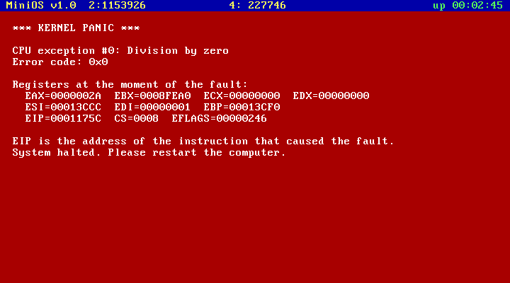

# 5. Прерывания и исключения

Файлы: [`kernel/interrupts.c`](../kernel/interrupts.c), [`kernel/isr.asm`](../kernel/isr.asm),
[`kernel/interrupts.h`](../kernel/interrupts.h)

Прерывания — **самая важная** для понимания ОС тема. На них держится всё: драйверы, время, многозадачность.

## 5.1. Что такое прерывание

Представьте, что программа ждёт нажатия клавиши. Можно в цикле постоянно спрашивать клавиатуру
«нажали? нажали? нажали?» — это называется **опрос** (polling). Процессор занят бесполезной работой.

Лучше так: процессор занимается своими делами, а клавиатура **сама сообщает**, когда что-то произошло.
Такой сигнал и называется **прерыванием** (interrupt). Получив его, процессор:

1. заканчивает текущую команду;
2. сохраняет в стек `EFLAGS`, `CS`, `EIP` — «куда потом вернуться»;
3. по номеру прерывания находит в таблице **IDT** адрес обработчика и прыгает туда;
4. обработчик делает свою работу и выполняет команду **`iret`**;
5. `iret` достаёт из стека `EIP`, `CS`, `EFLAGS` — и прерванная программа продолжает работу,
   даже не заметив, что её прерывали.

```
   Программа                          Обработчик прерывания
   ─────────                          ─────────────────────
   mov eax, 5
   add eax, ebx    ◄── IRQ1 (клавиша!)
         │ процессор сохраняет EIP, CS, EFLAGS
         └──────────────────────────► сохранить регистры
                                      прочитать скан-код из порта 0x60
                                      положить символ в буфер
                                      сообщить PIC: «обработано» (EOI)
                                      восстановить регистры
         ┌─────────────────────────── iret
         ▼
   mov ecx, eax    ← продолжаем как ни в чём не бывало
```

## 5.2. Виды прерываний

| Вид | Источник | Векторы в MiniOS | Примеры |
|---|---|---|---|
| **Исключения** (exceptions) | сам процессор, при ошибке в команде | 0–31 | деление на ноль (#0), неверная команда (#6), General Protection Fault (#13), Page Fault (#14) |
| **Аппаратные прерывания** (IRQ) | устройства | 32–47 | таймер (IRQ0 → 32), клавиатура (IRQ1 → 33) |
| **Программные прерывания** | команда `int n` | любые | так программы вызывают ядро: `int 0x80` в Linux |

Всего векторов 256. Номера 0–31 Intel зарезервировала под исключения.

## 5.3. Таблица IDT

**IDT** (Interrupt Descriptor Table) — массив из 256 записей по 8 байт. Запись номер N говорит
процессору, где лежит обработчик прерывания N:

```c
struct idt_entry {
    uint16_t offset_low;    // адрес обработчика, биты 0–15
    uint16_t selector;      // сегмент кода: 0x08 (из нашей GDT)
    uint8_t  zero;
    uint8_t  type_attr;     // 0x8E: присутствует, кольцо 0, 32-битный шлюз прерывания
    uint16_t offset_high;   // адрес обработчика, биты 16–31
} __attribute__((packed));
```

`__attribute__((packed))` запрещает компилятору вставлять между полями выравнивающие пустые байты —
формат записи задан процессором, и он должен совпадать байт в байт.

Заполнив массив, сообщаем процессору его адрес командой `lidt` — так же, как `lgdt` для GDT.

## 5.4. Обработчики: ассемблер + C

Обработчик прерывания обязан **сохранить все регистры** прерванной программы и закончиться командой
`iret`. На C так не написать, поэтому сделано в два слоя.

**1. Заглушки на ассемблере** (`isr.asm`) — по одной на каждый вектор, все одинаковые:

```nasm
isr0:                   ; деление на ноль
    push dword 0        ; фиктивный код ошибки (для единообразия)
    push dword 0        ; номер прерывания
    jmp  isr_common

irq1:                   ; клавиатура
    push dword 0
    push dword 33       ; IRQ1 → вектор 33
    jmp  isr_common
```

Некоторые исключения (8, 10–14, 17) процессор сопровождает **кодом ошибки** — он сам кладёт его в стек.
Для остальных заглушка кладёт фиктивный 0, чтобы стек всегда имел одинаковую структуру.

**2. Общая часть `isr_common`** сохраняет регистры и вызывает C:

```nasm
isr_common:
    pusha               ; сохранить EAX, ECX, EDX, EBX, ESP, EBP, ESI, EDI
    push ds / es / fs / gs
    push esp            ; аргумент для C — указатель на всё сохранённое
    call interrupt_handler
    mov  esp, eax       ; ← (!) см. главу 8 — здесь переключаются задачи
    pop  gs / fs / es / ds
    popa
    add  esp, 8         ; убрать номер прерывания и код ошибки
    iret
```

После сохранения стек выглядит так — и это **в точности** структура `struct regs` из `interrupts.h`:

```
 младшие адреса  ESP → ┌──────────────┐
                       │ gs fs es ds   │ ← push вручную
                       │ edi esi ebp   │
                       │ esp ebx edx   │ ← pusha
                       │ ecx eax       │
                       │ int_no        │ ← заглушка
                       │ err_code      │
                       │ eip cs eflags │ ← процессор
 старшие адреса        └──────────────┘
```

Поэтому C-функция может просто прочитать `r->int_no` или `r->eip`.

**3. Диспетчер на C** `interrupt_handler(struct regs *r)`:

```c
if (r->int_no < 32)        kernel_panic(r);            // исключение — авария
else if (r->int_no < 48) {                              // IRQ от устройства
    irq_handlers[irq](r);                               // вызвать драйвер
    outb(0x20, 0x20);                                   // EOI контроллеру
    if (irq == 0) r = schedule(r);                      // таймер → планировщик
}
return r;
```

Драйверы регистрируют свои обработчики через `irq_install_handler(номер, функция)`:
таймер — для IRQ0, клавиатура — для IRQ1.

## 5.5. Контроллер прерываний PIC 8259

Устройства не подключены к процессору напрямую — между ними стоит **контроллер прерываний PIC**.
Точнее, два, соединённых **каскадом**: ведомый подключён ко входу IRQ2 ведущего.

```
 Таймер ──── IRQ0 ─┐
 Клавиатура  IRQ1 ─┤  ┌────────────┐
            IRQ2 ◄─┼──┤  ведущий   ├── INT ──► процессор
 COM2 ────── IRQ3 ─┤  │  PIC #1    │
 ...               ┘  └────────────┘
 Часы RTC ── IRQ8 ─┐  ┌────────────┐
 Мышь ───── IRQ12 ─┤  │  ведомый   ├── выход в IRQ2 ведущего
 Диск ───── IRQ14 ─┘  │  PIC #2    │
                      └────────────┘
```

PIC решает три задачи: собирает 16 линий в одну, расставляет приоритеты
(меньший номер IRQ — выше приоритет) и сообщает процессору номер вектора.

### Перенастройка (remap)

По умолчанию BIOS настраивает PIC так, что IRQ0–7 приходят на векторы 8–15. Но это векторы
исключений процессора! Тик таймера был бы неотличим от исключения «двойная ошибка» (#8).
Поэтому `pic_remap()` отправляет контроллерам последовательность команд инициализации ICW1–ICW4
и переносит IRQ0–15 на векторы **32–47**.

Заодно настраивается **маска**: какие IRQ разрешены. Мы разрешаем только таймер, клавиатуру и каскад.

### EOI — «прерывание обработано»

После каждого аппаратного прерывания обработчик **обязан** послать контроллеру команду EOI
(End Of Interrupt, байт `0x20` в порт `0x20`). Пока EOI не получен, PIC не пришлёт новых прерываний
этого и более низкого приоритета. Забыть EOI — классическая ошибка: таймер «тикнет» ровно один раз,
и система замрёт.

## 5.6. Исключения и kernel panic

Если процессор не может выполнить команду, он генерирует исключение. Попробуйте команду `crash`:
она делит на ноль, процессор вызывает исключение #0, и MiniOS показывает «экран смерти» с содержимым
регистров на момент ошибки:



`EIP` — адрес команды, которая вызвала ошибку. По нему и отладочной информации в `build/kernel.elf`
можно найти точное место в исходном коде:

```
$ addr2line -f -e build/kernel.elf 0x1175C
cmd_crash
kernel/shell.c:241
```

(адрес у вас может отличаться, если вы меняли код). Так разработчики ОС разбирают отчёты о сбоях.

В настоящих ОС исключение в **программе пользователя** не роняет систему: ядро просто завершает
программу (в Linux она получает сигнал `SIGFPE` или `SIGSEGV`, в Windows — «Программа выполнила
недопустимую операцию»). А вот исключение в **самом ядре** — это и есть «синий экран» Windows
или kernel panic в Linux. Исключения используются и для полезной работы: **Page Fault** (#14) — основа
виртуальной памяти и подкачки.

## 5.7. Запрет прерываний и критические секции

Команда `cli` запрещает аппаратные прерывания, `sti` — разрешает. Это нужно, когда код работает
с общими данными, которые может изменить обработчик прерывания или другая задача. Например, `kmalloc`
запрещает прерывания на время поиска блока — иначе планировщик мог бы переключиться на другую
задачу посреди изменения списка блоков, и та увидела бы его в «полуразобранном» виде.
Такой участок кода называется **критической секцией** (подробнее — в главе 8).

---
[← 4. Ядро и экран](04-yadro-i-ekran.md) · Далее: [6. Таймер и клавиатура →](06-tajmer-i-klaviatura.md)
