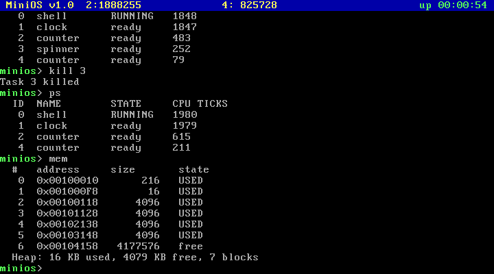

# 8. Многозадачность и планировщик

Файлы: [`kernel/task.c`](../kernel/task.c), [`kernel/isr.asm`](../kernel/isr.asm),
[`kernel/programs.c`](../kernel/programs.c)

## 8.1. Идея

У нашего компьютера один процессор, и в каждый момент он выполняет ровно одну команду. Но MiniOS
одновременно показывает часы, крутит «вертушку», считает счётчики и принимает команды. Как?

**Разделение времени** (time sharing): процессор очень быстро переключается между задачами —
у нас 100 раз в секунду. Каждая задача получает **квант времени** 10 мс, потом её приостанавливают
и запускают следующую. Человеку кажется, что всё работает параллельно.



Синяя строка вверху: `2:1888255` и `4: 825728` — два счётчика, `up 00:00:54` — часы.
Команда `ps` показывает, сколько тиков процессорного времени получила каждая задача.

## 8.2. Что такое задача для процессора

Процессор не знает слова «задача». Для него существует только **текущее состояние**:

* регистры общего назначения (`EAX`, `EBX`, ...);
* **`EIP`** — адрес следующей команды («где мы в программе»);
* **`ESP`** — вершина стека («локальные переменные и цепочка вызовов функций»);
* `EFLAGS` — флаги.

Всё это вместе называется **контекстом**. Если сохранить контекст задачи A, загрузить контекст задачи B,
а потом вернуть контекст A — задача A продолжит работу ровно с того же места, ничего не заметив.
Поэтому каждой задаче нужны: **свой стек** и **место для сохранения регистров**.

В MiniOS описание задачи — `struct task`:

```c
struct task {
    int      id;           // номер
    char     name[16];     // имя (для ps)
    int      state;        // READY / RUNNING / DEAD
    uint32_t esp;          // где в её стеке лежат сохранённые регистры
    void    *stack;        // 4 КБ памяти под стек (из kmalloc)
    void   (*entry)(void); // функция, с которой задача начинается
    uint32_t ticks;        // сколько квантов отработала
};
```

В настоящих ОС эта структура называется **PCB** (Process Control Block, блок управления процессом),
в Linux — `task_struct` (в ней сотни полей: открытые файлы, права, адресное пространство...).

## 8.3. Переключение контекста — главный трюк

Вспомним из главы 5: при **любом** прерывании `isr_common` сохраняет все регистры в стек
прерванной задачи и передаёт в C указатель на них. А потом:

```nasm
    push esp
    call interrupt_handler
    mov  esp, eax       ; ← ESP = то, что вернула C-функция
    pop  gs ... popa
    iret
```

Обычно `interrupt_handler` возвращает тот же указатель, и всё восстанавливается как было.
Но после тика таймера вызывается **планировщик**, и он может вернуть **указатель на сохранённые
регистры другой задачи**. Тогда `mov esp, eax` переключает нас на чужой стек, `popa` восстанавливает
чужие регистры, а `iret` прыгает на чужой `EIP`. **Мы оказываемся в другой задаче.**

```
     Задача A (стек A)                                   Задача B (стек B)
     ─────────────────                                   ─────────────────
     ... выполняется ...                                  (спит; на её стеке
          │                                                лежат её регистры,
          ▼  тик таймера (IRQ0)                            сохранённые в
     isr_common: регистры A → стек A                       прошлый раз)
          │                                                    ▲
     schedule(regs_A):                                         │
        tasks[A].esp = regs_A    ← запомнили, где A            │
        выбрали B                                              │
        return tasks[B].esp      ───────────────────────────► mov esp, eax
                                                              popa  ← регистры B
                                                              iret  ← EIP задачи B
                                                                   │
                                                              ... B выполняется ...
```

Весь планировщик — около 20 строк:

```c
struct regs *schedule(struct regs *r) {
    tasks[current].esp = (uint32_t)r;          // 1. сохранить, где регистры текущей
    tasks[current].ticks++;
    if (tasks[current].state == TASK_RUNNING)
        tasks[current].state = TASK_READY;

    for (i = 1; i <= MAX_TASKS; i++) {         // 2. найти следующую готовую по кругу
        int c = (current + i) % MAX_TASKS;
        if (tasks[c].state == TASK_READY) { next = c; break; }
    }

    current = next;                            // 3. переключиться
    tasks[current].state = TASK_RUNNING;
    return (struct regs *)tasks[current].esp;
}
```

## 8.4. Как запустить новую задачу

Проблема: переключиться можно только на задачу, у которой на стеке **уже лежат сохранённые регистры**.
У новой задачи их нет — она ещё ни разу не выполнялась.

Решение: `task_create` **подделывает** стек новой задачи — кладёт туда `struct regs` так,
будто задача уже была прервана таймером:

```c
uint32_t top = (uint32_t)stack + 4096;              // стек растёт вниз — начинаем с конца
struct regs *r = (struct regs *)(top - sizeof(struct regs));
r->eip    = (uint32_t)task_start;  // «вернуться» в начало задачи
r->cs     = 0x08;                  // сегмент кода ядра
r->eflags = 0x202;                 // бит IF = 1: прерывания будут разрешены
r->ds = r->es = r->fs = r->gs = 0x10;
task->esp = (uint32_t)r;
task->state = TASK_READY;
```

```
 стек новой задачи (4096 байт)
 ┌───────────────────────────────┬──────────────────────────────┐
 │        пока пусто              │ gs fs es ds | edi ... eax |  │
 │                               │ 0 0 | eip=task_start cs eflags│
 └───────────────────────────────┴──────────────────────────────┘
 stack                           ▲ task->esp                    stack + 4096
```

При следующем тике планировщик выберет новую задачу, `isr_common` «восстановит» эти поддельные
регистры, и `iret` прыгнет на `task_start`, которая вызовет функцию задачи.
Если функция когда-нибудь закончится, `task_start` вызовет `task_exit()`.

Задача 0 (оболочка) особенная: её не создают — она уже выполняется на стеке ядра, когда вызывается
`tasking_init()`. Её регистры сохранятся сами при первом же тике таймера.

## 8.5. Состояния задачи

```
              task_create()
                   │
                   ▼
   ┌───────► ┌─────────┐   планировщик выбрал   ┌──────────┐
   │         │  READY  │ ─────────────────────► │ RUNNING  │
   │         │(готова) │ ◄───────────────────── │(работает)│
   │         └─────────┘   тик таймера:         └────┬─────┘
   │                       квант истёк               │
   │                                                 │ task_exit() или kill
   │         ┌─────────┐                             │
   └──────── │  DEAD   │ ◄───────────────────────────┘
 слот        │(заверш.)│
 используется└─────────┘
 снова
```

В настоящих ОС есть ещё состояние **BLOCKED** (ожидание): задача, ждущая клавишу, диск или сеть,
вообще не получает процессор, пока событие не произойдёт. В MiniOS ожидание сделано проще — через
`hlt` в цикле: задача получает квант, проверяет условие и засыпает до следующего прерывания.
Это работает, но тратит кванты впустую. Улучшение «блокирующего ожидания» — хорошее упражнение.

## 8.6. Алгоритм Round Robin

MiniOS использует простейший алгоритм — **циклический** (Round Robin): задачи стоят в кругу
и получают процессор по очереди, каждая на один квант.

Проверьте справедливость сами: `run counter`, `run counter` — оба счётчика растут с почти одинаковой
скоростью. А `ps` покажет, что все задачи получили примерно поровну тиков.

Другие алгоритмы планирования:

| Алгоритм | Идея | Где используется |
|---|---|---|
| FIFO (FCFS) | выполнять задачу до конца, потом следующую | пакетные системы, без вытеснения |
| Round Robin | по кругу, по кванту | основа большинства планировщиков |
| Приоритетный | сначала задачи с высоким приоритетом | Windows (32 уровня приоритета) |
| Многоуровневые очереди с обратной связью | интерактивные задачи получают приоритет | классический Unix, Windows |
| CFS / EEVDF | выбирать задачу, получившую меньше всего времени | Linux |

## 8.7. Вытесняющая и кооперативная многозадачность

* **Кооперативная**: задача сама отдаёт процессор (вызывает `yield()`). Если она зависнет в цикле —
  зависнет вся система. Так работали Windows 3.x и Mac OS до версии 9.
* **Вытесняющая** (preemptive): процессор отнимает таймер, задачу никто не спрашивает. MiniOS, как и все
  современные ОС, использует этот вариант. Проверьте: `counter_task` — бесконечный цикл без всяких
  пауз, но оболочка продолжает отвечать.

## 8.8. Состояние гонки и критические секции

Когда задачи переключаются в произвольный момент, появляется новая проблема.
Пусть две задачи выполняют `counter = counter + 1`. Для процессора это три команды:

```
   Задача A                    Задача B                 counter
   mov eax, [counter]                                   5
                     ← переключение
                               mov eax, [counter]       5
                               add eax, 1
                               mov [counter], eax       6
                     ← переключение
   add eax, 1        (в EAX у A всё ещё 5!)
   mov [counter], eax                                   6   ← должно быть 7!
```

Это **состояние гонки** (race condition). Защита — **критическая секция**: участок кода, который
нельзя прерывать. На одном процессоре проще всего запретить прерывания (`cli` ... `sti`), что
и делают `kmalloc`, `task_create`, `task_kill` в MiniOS. На многопроцессорных системах этого
мало — нужны **спин-блокировки** (spinlock) на атомарных командах, **мьютексы** и **семафоры**.

В MiniOS фоновые задачи пишут только в свои клетки строки состояния через `vga_write_at` и не трогают
курсор оболочки — поэтому они не мешают друг другу.

## 8.9. Процессы и потоки

Задачи MiniOS — это, строго говоря, **потоки ядра** (kernel threads): у каждой свой стек и свои
регистры, но память общая. В настоящих ОС:

* **поток** (thread) — то же самое: свои регистры и стек, общая память с другими потоками процесса;
* **процесс** (process) — программа со своим **изолированным адресным пространством**
  (своими таблицами страниц), открытыми файлами, правами. В процессе один или несколько потоков.

При переключении между процессами ОС, кроме регистров, меняет и таблицы страниц (регистр `CR3`),
поэтому каждый процесс видит только свою память.

---
[← 7. Память](07-pamyat.md) · Далее: [9. Файловая система →](09-fajlovaya-sistema.md)
