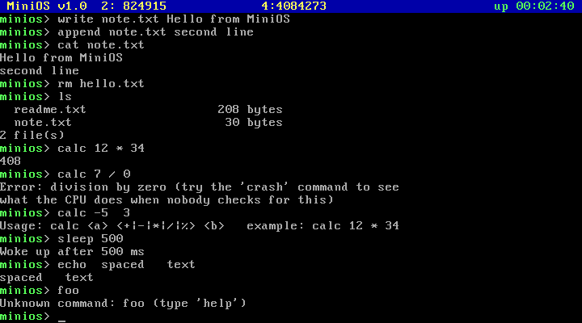

# 9. Файловая система

Файл: [`kernel/fs.c`](../kernel/fs.c)

## 9.1. Что такое файловая система

Диск для компьютера — просто огромный массив пронумерованных **секторов** по 512 байт (или 4 КБ).
Никаких «файлов» и «папок» на нём нет. **Файловая система** (ФС) — это способ организовать данные
на диске так, чтобы их можно было найти **по имени**.

Любая ФС хранит две вещи:

1. **Метаданные** — «оглавление»: какие файлы есть, как называются, какого размера, когда созданы,
   кому принадлежат и **где лежат их данные**.
2. **Данные** — само содержимое файлов.

## 9.2. Файловая система MiniOS

Для простоты MiniOS хранит всё в **оперативной памяти** (такие ФС называются RAM FS; в Linux это
`tmpfs`, например каталог `/tmp`). Поэтому после перезагрузки файлы пропадают.

**Метаданные** — массив из 32 записей:

```c
struct file {
    char     name[24];   // имя
    char    *data;       // указатель на содержимое (память из kmalloc)
    uint32_t size;       // размер в байтах
    bool     used;       // занята ли запись
};
static struct file files[32];
```

**Данные** — блоки в куче:

```
  Таблица файлов (в .bss ядра)           Куча (kmalloc)
 ┌────┬──────────────┬──────┬──────┐
 │ 0  │ "readme.txt" │ 208  │ data ├──────► "Welcome to MiniOS!\nThis file..."
 │ 1  │ "hello.txt"  │ 14   │ data ├──────► "Hello, world!\n"
 │ 2  │ "note.txt"   │ 30   │ data ├──────► "Hello from MiniOS\nsecond line\n"
 │ 3  │ (свободна)   │      │      │
 │ ...│              │      │      │
 └────┴──────────────┴──────┴──────┘
```

## 9.3. Операции

| Функция | Команда | Что делает |
|---|---|---|
| `fs_find(name)` | — | перебирает таблицу, сравнивает имена (`strcmp`) |
| `fs_write(name, data, size)` | `write` | ищет файл или свободную запись; выделяет новый буфер, копирует данные, освобождает старый |
| `fs_append(name, data, size)` | `append` | выделяет буфер размером «старое + новое», копирует оба куска |
| `fs_delete(name)` | `rm` | освобождает данные (`kfree`) и обнуляет запись |
| `fs_get(i)` | `ls` | перебор всех файлов |
| — | `cat` | `fs_find` + вывод `data` на экран |

Обратите внимание, как подсистемы ядра опираются друг на друга: ФС использует менеджер памяти
(`kmalloc`/`kfree`), а оболочка — ФС.

Попробуйте:

```
minios> ls
minios> write todo.txt buy milk
minios> append todo.txt learn OS
minios> cat todo.txt
minios> rm hello.txt
minios> mem          ← данные файлов видны как USED-блоки в куче
```



## 9.4. Как устроены настоящие файловые системы

Настоящие ФС хранят всё на диске. Рассмотрим две классические схемы.

### FAT (File Allocation Table) — флешки, карты памяти

```
 ┌───────────┬───────────────┬─────────────────┬──────────────────────────────┐
 │ загрузоч. │ таблица FAT   │ корневой каталог│ область данных (кластеры)     │
 │ сектор    │ (цепочки)     │ (имена файлов)  │  2 │ 3 │ 4 │ 5 │ 6 │ 7 │ ... │
 └───────────┴───────────────┴─────────────────┴──────────────────────────────┘
 Каталог:  "PHOTO.JPG", размер 10 КБ, первый кластер = 3
 FAT:      [3] → 4,  [4] → 7,  [7] → конец
 Значит, файл лежит в кластерах 3, 4, 7.
```

Каталог хранит имя и номер **первого кластера**, а таблица FAT — для каждого кластера номер
**следующего**. Файл — это цепочка кластеров.

### ext2/ext4 (Linux) и индексные дескрипторы

Метаданные файла хранятся в **inode** (индексном дескрипторе): размер, права, владелец, время и
**список номеров блоков** с данными. Каталог — это особый файл, содержащий пары «имя → номер inode».
Отсюда «жёсткие ссылки»: два имени могут указывать на один inode.

### Что ещё делает настоящая ФС

* **каталоги** (иерархия папок) и пути вида `/home/user/file.txt`;
* **права доступа** (кто может читать и писать);
* **кеширование**: часто используемые блоки диска держатся в памяти;
* **журналирование** (ext4, NTFS): сначала изменения записываются в журнал, потом применяются —
  так ФС не разрушится при внезапном отключении питания;
* **виртуальная файловая система** (VFS): единый интерфейс `open/read/write/close` для всех типов ФС.

Чтобы MiniOS научилась хранить файлы на диске, ей понадобятся: драйвер диска (ATA PIO — чтение
и запись секторов через порты `0x1F0`–`0x1F7`) и формат хранения таблицы файлов на диске.

---
[← 8. Многозадачность](08-mnogozadachnost.md) · Далее: [10. Оболочка →](10-obolochka.md)
